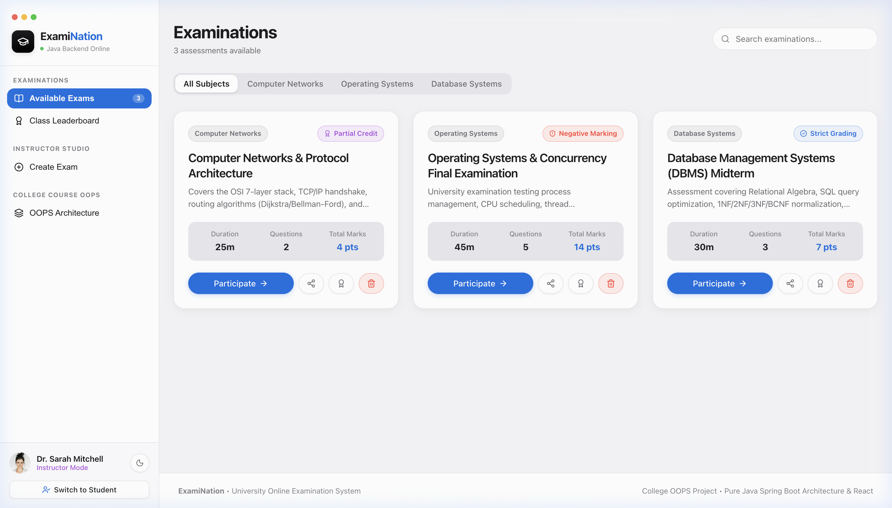
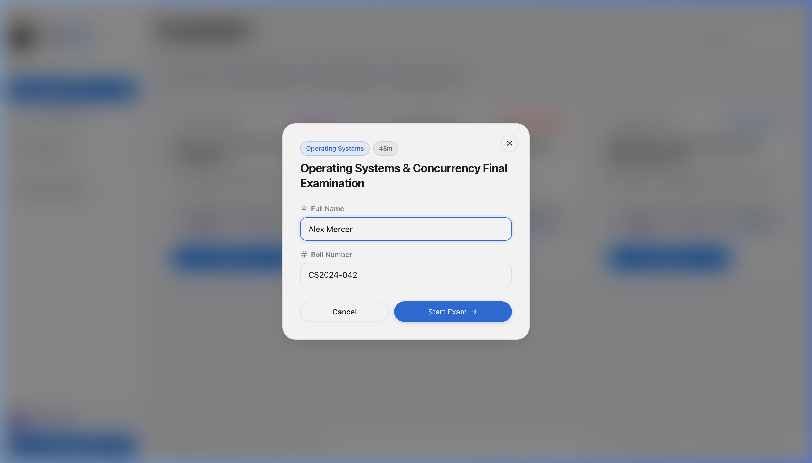
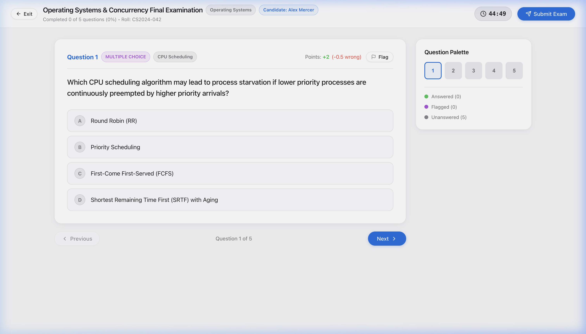
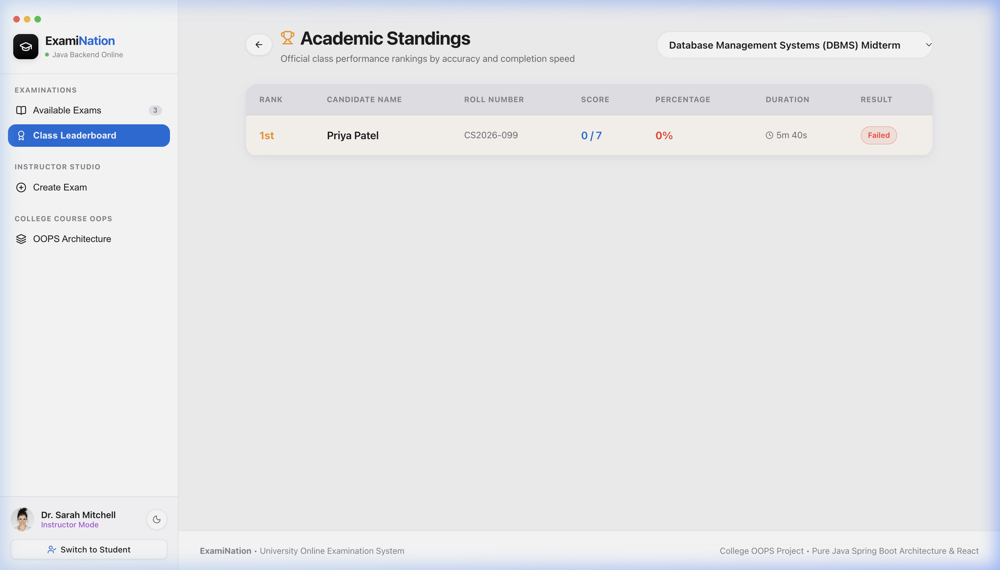
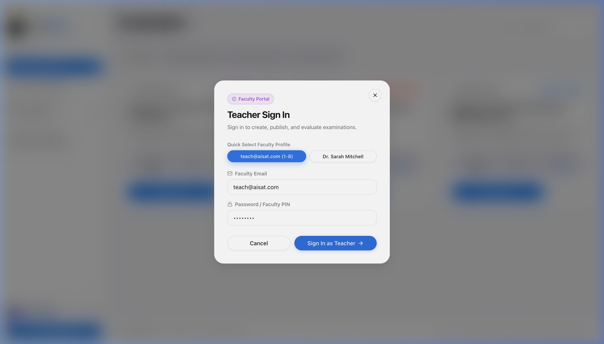
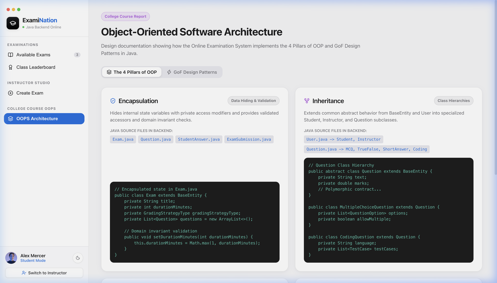

# ONLINE EXAMINATION SYSTEM

**A Course Project Report Submitted**  
**in Partial Fulfillment of the Requirements for the Completion of the Course**  
**PECMT535 OBJECT ORIENTED PROGRAMMING CONCEPTS**

in  
**Computer Science and Engineering (Artificial Intelligence and Machine Learning)**

By  
**RINZAN N.P (AIK24AM050)**  
**DINAH MOHAMMED (AIK24AM025)**

---

### DEPARTMENT OF ARTIFICIAL INTELLIGENCE AND MACHINE LEARNING
**Albertian Institute of Science and Technology - AISAT (AUTONOMOUS)**  
Kalamassery – Kochi 682022  
**2024-2028**

Affiliated to  
**APJ Abdul Kalam Technological University Thiruvananthapuram - Kerala**

---

\newpage

## Vision

To achieve excellence in education, research, and innovation in Artificial Intelligence and Machine Learning through ethical AI practices, industry collaboration, entrepreneurship, and sustainable technological solutions, nurturing globally competent and socially committed engineers.

## Mission

- To create strong foundational knowledge and professional competence in Artificial Intelligence and Machine Learning through outcome-based, research-oriented, and interdisciplinary learning.
- To nurture industry-ready, innovative, and entrepreneurial engineers by encouraging the development of real-world applications through industry collaboration and the use of state-of-the-art technologies.
- To inculcate ethical values and social responsibility, enabling students to develop sustainable and intelligent solutions that positively impact society and address global challenges.

## Motto

We make Engineers, not just Engineering Graduates.

---

\newpage

## Program Outcomes (POs)

At the end of the program, graduate engineers will be able to:

- **PO1 - Engineering Knowledge**: Apply knowledge of mathematics, natural science, computing, engineering fundamentals and an engineering specialization as specified in WK1 to WK4 respectively to develop solutions to complex engineering problems.
- **PO2 - Problem Analysis**: Identify, formulate, review research literature and analyze complex engineering problems reaching substantiated conclusions with consideration for sustainable development. (WK1 to WK4)
- **PO3 - Design/Development of Solutions**: Design creative solutions for complex engineering problems and design/develop systems/components/processes to meet identified needs with consideration for public health and safety, whole-life cost, net zero carbon, culture, society and environment as required. (WK5)
- **PO4 - Conduct investigations of complex problems**: Conduct investigations of complex engineering problems using research-based knowledge including design of experiments, modelling, analysis & interpretation of data to provide valid conclusions. (WK8)
- **PO5 - Modern tool usage**: Create, select and apply appropriate techniques, resources and modern engineering & IT tools, including prediction and modelling recognizing their limitations to solve complex engineering problems. (WK2 and WK6)
- **PO6 - The Engineer and The World**: Analyze and evaluate societal and environmental aspects while solving complex engineering problems for its impact on sustainability with reference to economy, health, safety, legal framework, culture and environment. (WK1, WK5, and WK7)
- **PO7 - Ethics**: Apply ethical principles and commit to professional ethics, human values, diversity and inclusion; adhere to national & international laws. (WK9)
- **PO8 - Individual and Collaborative Team work**: Function effectively as an individual, and as a member or leader in diverse/multi-disciplinary teams.
- **PO9 - Communication**: Communicate effectively and inclusively within the engineering community and society at large, such as being able to comprehend and write effective reports and design documentation, make effective presentations considering cultural, language, and learning differences.
- **PO10 - Project management and Finance**: Apply knowledge and understanding of engineering management principles and economic decision-making and apply these to one's own work, as a member and leader in a team, and to manage projects in multidisciplinary environments.
- **PO11 - Life-Long learning**: Recognize the need for, and have the preparation and ability for:
  - (i) independent and life-long learning
  - (ii) adaptability to new and emerging technologies and
  - (iii) critical thinking in the broadest context of technological change. (WK8)

---

\newpage

## COURSE OUTCOMES (COs)

After the completion of the course, the student will be able to:

| CO | Course Outcome | Bloom's Knowledge Level (KL) |
| :--- | :--- | :--- |
| **CO1** | Explain the structure and workflow of the Online Examination System and its major components. | K2 (Understand) |
| **CO2** | Apply object-oriented principles to organize exam, user and submission-related components. | K3 (Apply) |
| **CO3** | Use service interfaces, repositories and DTOs to support modular application design. | K3 (Apply) |
| **CO4** | Analyze submission status, feedback, analytics and event/observer components in the application. | K4 (Analyze) |
| **CO5** | Evaluate the usability and functional behavior of the online examination portal through testing. | K5 (Evaluate) |

*Note: K1 - Remember, K2 - Understand, K3 - Apply, K4 - Analyze, K5 - Evaluate, K6 - Create.*

### CO-PO Mapping Matrix

| PO / CO | PO 1 | PO 2 | PO 3 | PO 4 | PO 5 | PO 6 | PO 7 | PO 8 | PO 9 | PO 10 | PO 11 |
| :--- | :---: | :---: | :---: | :---: | :---: | :---: | :---: | :---: | :---: | :---: | :---: |
| **CO1** | 3 | 3 | - | - | 3 | - | - | - | - | - | - |
| **CO2** | 3 | 3 | 3 | - | 3 | - | - | - | - | - | - |
| **CO3** | 3 | 3 | 3 | - | 3 | - | - | - | - | - | - |
| **CO4** | 3 | 3 | - | 3 | 3 | - | - | - | - | - | - |
| **CO5** | 3 | 3 | 3 | 3 | 3 | - | - | 3 | 3 | - | - |

*Correlation Levels: 3 - High, 2 - Medium, 1 - Low, (-) - No Correlation.*

---

\newpage

## SDG MAPPING

| SDG # | SDG Goal | Relevance to the Project |
| :--- | :--- | :--- |
| **SDG 4** | **Quality Education** | Provides an accessible digital platform for administering academic assessments, standardizing evaluations, and offering transparent instant feedback to learners and faculty members. |
| **SDG 9** | **Industry, Innovation and Infrastructure** | Implements clean enterprise software patterns, decoupled service layers, and automated algorithmic evaluation tools supporting scalable digital educational infrastructure. |
| **SDG 10** | **Reduced Inequalities** | Delivers equalized examination conditions with synchronized countdown timers, standardized objective marking, and barrier-free access through clean browser interfaces. |
| **SDG 16** | **Peace, Justice and Strong Institutions** | Ensures accountable assessment records through immutable submission histories, reproducible grading policies, and transparent class performance metrics. |

---

\newpage

## UNDERTAKING

We declare that the work presented in this project titled **"Online Examination System"**, submitted to the Department of Artificial Intelligence and Machine Learning, Albertian Institute of Science and Technology - AISAT (AUTONOMOUS), Kalamassery-Kochi for the award of the Bachelor of Technology degree in Computer Science and Engineering (Artificial Intelligence and Machine Learning), is our original work. We have not plagiarized or submitted the same work for the award of any other degree. In case this undertaking is found incorrect, we accept that our degree may be unconditionally withdrawn.

**Date:** 27-10-2026  
**Place:** Kalamassery

**RINZAN N.P (AIK24AM050)**  
**DINAH MOHAMMED (AIK24AM025)**

---

\newpage

## CERTIFICATE

Certified that the work contained in the project titled **"Online Examination System"**, by **Rinzan N.P (AIK24AM050)** and **Dinah Mohammed (AIK24AM025)**, has been carried out under my supervision and that this work has not been submitted elsewhere for a degree.

**Ms. Ashwathy Anda Chacko**  
Assistant Professor  
Department of Artificial Intelligence and Machine Learning  
Albertian Institute of Science and Technology - AISAT (AUTONOMOUS)  
Kalamassery, Kochi - 682022

---

\newpage

## APPROVAL & EVALUATION

Presentation for the B. Tech Semester V Project Evaluation  
**(PECMT535 OBJECT ORIENTED PROGRAMMING CONCEPTS)**

Held on: ........................................

**Evaluation Committee:**

1. ............................................................
2. ............................................................

---

\newpage

## ACKNOWLEDGEMENT

We would like to express our gratitude to **Dr. Veena V**, Principal, Albertian Institute of Science and Technology - AISAT (AUTONOMOUS), for providing an encouraging academic environment and excellent facilities.

We also express our heartfelt gratitude to our course faculty, **Ms. Ashwathy Anda Chacko**, Department of Artificial Intelligence and Machine Learning, for her valuable suggestions, constructive critique, and guidance throughout the conceptualization, object-oriented design, and implementation of this project.

Finally, we thank our peers and staff members of the Department of Artificial Intelligence and Machine Learning for their continuous support during this academic endeavor.

**Date:** 27-10-2026  
**Place:** Kalamassery  

**Rinzan N.P (AIK24AM050)**  
**Dinah Mohammed (AIK24AM025)**

---

\newpage

## ABSTRACT

The **Online Examination System** is an enterprise-grade academic assessment web platform engineered to demonstrate core Object-Oriented Programming (OOP) principles and classic Gang-of-Four (GoF) design patterns. Developed for the course *PECMT535 Object Oriented Programming Concepts*, the system provides a complete digital assessment lifecycle spanning examination authoring, secure participant verification, automated polymorphic evaluation, dynamic real-time scoring, and academic performance analytics.

The backend is built in **Java 17** using the **Spring Boot** framework and Gradle. It implements the four foundational pillars of OOP: **Encapsulation** through self-validating domain entities (`Exam`, `Question`, `ExamSubmission`, `User`); **Inheritance** via cohesive hierarchy models rooted in `BaseEntity` (abstract `Question` with specialized subtypes `MultipleChoiceQuestion`, `TrueFalseQuestion`, `ShortAnswerQuestion`, and `CodingQuestion`; and abstract `User` extended by `Student` and `Instructor`); **Polymorphism** through dynamic method dispatch in evaluation routines (`question.evaluate(...)`) and role descriptors; and **Abstraction** via service contracts (`ExamService`, `SubmissionService`, `UserService`) and repository abstractions (`ExamRepository`, `UserRepository`, `SubmissionRepository`). Furthermore, the architecture embeds four GoF design patterns: the **Strategy Pattern** for interchangeable grading algorithms (`StrictGradingStrategy`, `NegativeMarkingStrategy`, `PartialCreditStrategy`), the **Factory Pattern** (`QuestionFactory`) for encapsulated question generation, the **Observer Pattern** (`ExamEventPublisher`, `NotificationObserver`, `AnalyticsObserver`) for decoupled event notifications, and the **Builder Pattern** (`ExamBuilder`) for fluent domain object construction.

The frontend is constructed using **React 18** and **Vite**, featuring an Apple Human Interface Guidelines (HIG)-inspired design system with frosted glassmorphism, responsive split-view sidebar navigation, accessible dark/light themes, zero distracting emojis, and live countdown timers. Faculty members authenticate via secure role verification (`teach@aisat.com`), enabling full control over exam authoring and class analytics. Candidate students participate through a streamlined modal requiring full name and roll number, receiving instant algorithmic evaluation, radial score dials, question-by-question review, and class leaderboard rankings. Comprehensive functional verification confirms the reliability, modularity, and academic utility of the system.

---

\newpage

## TABLE OF CONTENTS

| Chapter No. | Contents | Page No. |
| :---: | :--- | :---: |
| | Certificate | i |
| | Approval and Evaluation | ii |
| | Acknowledgement | iii |
| | Abstract | iv |
| | Table of Contents | v |
| | List of Figures | vi |
| | List of Tables | vii |
| **1.** | **Introduction** | **1** |
| | 1.1 Background and Motivation | 1 |
| | 1.2 Scope and Relevance | 1 |
| | 1.3 Organization of the Report | 2 |
| **2.** | **Problem Statement** | **3** |
| **3.** | **Objectives** | **4** |
| **4.** | **Software Requirements** | **5** |
| | 4.1 Software and Hardware Requirements | 5 |
| | 4.2 Technologies and Component Stack | 5 |
| | 4.3 Functional Requirements | 6 |
| | 4.4 Non-Functional Requirements | 6 |
| | 4.5 Assessment and Subject Information | 7 |
| **5.** | **System Design** | **8** |
| | 5.1 Architecture of the System | 8 |
| | 5.2 Main System Components | 9 |
| | 5.3 OOP Concepts and Design Patterns Applied | 10 |
| | 5.4 Class Hierarchy and Package Structure | 13 |
| **6.** | **Description of Modules** | **14** |
| | 6.1 Authentication and Role Management Module | 14 |
| | 6.2 Exam Catalog and Search Module | 14 |
| | 6.3 Candidate Participation and Live Runner Module | 15 |
| | 6.4 Algorithmic Evaluation and Grading Strategy Engine | 15 |
| | 6.5 Leaderboard and Class Analytics Module | 16 |
| | 6.6 Event and Observer Notification Module | 16 |
| **7.** | **Implementation Details** | **17** |
| | 7.1 Working of the System | 17 |
| | 7.2 Grading Algorithms and Evaluation Policies | 18 |
| | 7.3 Input Handling and Exception-Safe Processing | 19 |
| | 7.4 Compilation, Build and Execution | 20 |
| **8.** | **Screenshots of the Application** | **21** |
| | 8.1 Examination Catalog and Dashboard View | 21 |
| | 8.2 Participant Registration and Verification Modal | 22 |
| | 8.3 Live Assessment Runner with Digital Countdown Timer | 23 |
| | 8.4 Academic Class Leaderboard View | 24 |
| | 8.5 Teacher Authentication and Faculty Dashboard | 25 |
| | 8.6 Object-Oriented Architecture Explorer | 26 |
| **9.** | **Testing** | **27** |
| | 9.1 Test Cases and Expected Results | 27 |
| | 9.2 Verification Results and Discussion | 29 |
| **10.** | **Conclusion** | **30** |
| | 10.1 Conclusion | 30 |
| | 10.2 Limitations | 30 |
| **11.** | **Future Scope** | **31** |
| **12.** | **References** | **32** |

---

\newpage

## LIST OF FIGURES

| Figure No. | Name of Figure | Page No. |
| :---: | :--- | :---: |
| **5.1** | High-Level Architecture of the Online Examination System | 8 |
| **5.2** | Object-Oriented Domain Model and Inheritance Class Diagram | 11 |
| **5.3** | GoF Strategy and Observer Pattern Interaction Diagram | 12 |
| **8.1** | Examination Catalog and Apple-Themed Dashboard View | 21 |
| **8.2** | Participant Name and Roll Number Registration Modal | 22 |
| **8.3** | Live Assessment Runner with Active Palette and Digital Countdown Timer | 23 |
| **8.4** | Class Leaderboard and Ranked Performance Distribution | 24 |
| **8.5** | Faculty Authentication Modal for AISAT Teachers | 25 |
| **8.6** | Object-Oriented Architecture and Design Pattern Explorer | 26 |

---

\newpage

## LIST OF TABLES

| Table No. | Name of Table | Page No. |
| :---: | :--- | :---: |
| **4.1** | Software and Hardware Requirements Specifications | 5 |
| **4.2** | Example Academic Assessments Configured in the System | 7 |
| **5.1** | Core Backend Components and Architectural Responsibilities | 9 |
| **5.2** | Mapping of OOP Pillars and GoF Patterns to Implementation Classes | 10 |
| **6.1** | Functional Modules of the Online Examination Platform | 14 |
| **7.1** | Comparison of Implemented Grading Strategies | 18 |
| **9.1** | Comprehensive Functional and Integration Test Cases | 27 |

---

\newpage

# Chapter 1: INTRODUCTION

## 1.1 Background and Motivation
Assessment is a foundational pillar of modern academic instruction. Traditional physical examination procedures introduce substantial operational overhead, requiring physical paper printing, invigilation logistics, manual script collection, physical grading, and laborious manual entry of scores into institutional records. In high-enrollment computer science and engineering disciplines, these manual steps introduce delays in providing feedback, are vulnerable to clerical errors, and make it difficult to gather quantitative insights into student learning outcomes.

An online examination platform unifies these workflows into a cohesive, algorithmic system. Digital assessment engines provide automated question distribution, synchronized timers, instant algorithmic grading, immediate pedagogical feedback, and automated performance tracking. When architected using clean **Object-Oriented Programming (OOP)** paradigms and **Gang-of-Four (GoF) Design Patterns**, such a system achieves high modularity, extensibility, testability, and maintainability.

The **Online Examination System** presented in this report is developed specifically for the course *PECMT535 Object Oriented Programming Concepts*. It demonstrates how theoretical concepts—such as polymorphism, encapsulation, interface-driven abstraction, and inheritance hierarchies—directly solve real-world software design challenges in an academic setting.

## 1.2 Scope and Relevance
The scope of this project encompasses an enterprise-grade full-stack assessment platform:
- **Backend Architecture**: Implemented in Java 17 using Spring Boot 3.2.5. It features decoupled domain models, in-memory repository abstractions, service contracts, data transfer objects (DTOs), and custom GoF pattern implementations.
- **Frontend Presentation**: Developed using React 18 and Vite. It utilizes an Apple Human Interface Guidelines (HIG)-inspired design language, custom CSS design tokens, responsive sidebar navigation, frosted glassmorphic backdrops, light/dark mode themes, and clean SVG iconography with zero extraneous emojis.
- **Role Workflows**:
  - *Candidates / Students*: Can inspect scheduled university assessments, register via clean full-name and roll-number prompts, execute timed examinations with dynamic question palettes, and receive immediate radial score metrics and question-level feedback.
  - *Faculty / Instructors*: Can authenticate using verified institutional credentials (`teach@aisat.com`), view live class performance metrics (total submissions, average score, pass rates), access student rankings on the class leaderboard, and create custom examinations.
- **Pedagogical Alignment**: The project includes a dedicated *OOPS Architecture Inspector* view within the user interface, mapping every active UI feature directly to the underlying Java class hierarchy, OOP pillar, or GoF design pattern.

## 1.3 Organization of the Report
This report is structured into twelve chapters:
- **Chapter 1** presents the background, motivation, scope, and structural layout of the report.
- **Chapter 2** details the problem statement addressed by digital assessment platforms.
- **Chapter 3** establishes the primary technical and pedagogical objectives of the project.
- **Chapter 4** outlines the software, hardware, functional, and assessment requirements.
- **Chapter 5** discusses the system design, architectural diagrams, OOP principles, and class hierarchies.
- **Chapter 6** details each functional module across the frontend and backend.
- **Chapter 7** elaborates on the implementation, evaluation algorithms, input validation, and execution steps.
- **Chapter 8** documents the application user interface through captured screenshots.
- **Chapter 9** presents the testing strategy, test cases, and functional validation results.
- **Chapter 10** summarizes the conclusions and notes system limitations.
- **Chapter 11** explores future development avenues and technological enhancements.
- **Chapter 12** provides academic and technical references.

---

\newpage

# Chapter 2: PROBLEM STATEMENT

Traditional examination administration across university engineering departments faces several critical operational bottlenecks:

1. **Scattered Assessment Records**: Exam schedules, question papers, candidate submissions, answer keys, and grading rubrics are frequently managed across disconnected channels (physical sheets, emails, or isolated spreadsheets).
2. **Delayed Feedback Loops**: Manual script evaluation often requires days or weeks, preventing students from immediately identifying conceptual weaknesses or reviewing model solutions while the material is fresh.
3. **Rigid and Error-Prone Grading**: Manual evaluation can lead to inconsistent application of grading rules (such as negative marking deductions or partial credit assignments) across different evaluators.
4. **Lack of Synchronized Real-Time Controls**: Paper-based or uncoordinated online quizzes often fail to enforce strict examination durations uniformly, creating potential disparities in assessment conditions.
5. **Architectural Rigidity in Academic Projects**: Many student-developed assessment portals rely on procedural scripting or monolithic controllers with tightly coupled database logic, violating fundamental software engineering principles like the Single Responsibility Principle (SRP) and Open/Closed Principle (OCP).

The **Online Examination System** addresses these issues by delivering a centralized, web-based platform with real-time synchronized timers, dynamic question rendering, polymorphic evaluation algorithms, and decoupled object-oriented architecture.

---

\newpage

# Chapter 3: OBJECTIVES

The technical and pedagogical objectives of the project are:

1. **Centralized Assessment Catalog**: To provide an accessible web interface for viewing university examinations categorized by subject, duration, question count, total marks, and grading policy.
2. **Pure Object-Oriented Design**: To structure the backend using the four foundational pillars of OOP:
   - *Encapsulation* of entity state and business invariants.
   - *Inheritance* hierarchies for users (`Student`, `Instructor`) and questions (`MultipleChoiceQuestion`, `TrueFalseQuestion`, `ShortAnswerQuestion`, `CodingQuestion`).
   - *Polymorphism* via dynamic method dispatch for question evaluation and role identification.
   - *Abstraction* separating high-level service contracts from concrete data storage implementations.
3. **GoF Design Pattern Integration**: To implement:
   - *Strategy Pattern* for swappable grading policies (`Strict`, `Negative Marking`, `Partial Credit`).
   - *Factory Pattern* for encapsulated instantiation of polymorphic questions.
   - *Observer Pattern* for event-driven asynchronous analytics and notification publishing.
   - *Builder Pattern* for step-by-step construction of complex examination entities.
4. **Seamless Role Workflows**: To support secure faculty authentication (`teach@aisat.com` / `1-8`) alongside frictionless candidate participation using full name and university roll number.
5. **Interactive Assessment Runner**: To deliver a distraction-free exam environment featuring synchronized digital countdown timers, color-coded question palettes, and immediate submission reviews.
6. **Class-Wide Academic Analytics**: To compute real-time metrics including class averages, pass rates, submission counts, and ranked student leaderboards.
7. **Clean Apple Human Interface Design**: To craft a polished, accessible frontend interface adhering to Apple HIG principles, featuring frosted glassmorphism, responsive navigation, dark/light themes, and zero emojis.

---

\newpage

# Chapter 4: SOFTWARE REQUIREMENTS

## 4.1 Software and Hardware Requirements
The development and operational specifications for the system are detailed in Table 4.1.

### Table 4.1: Software and Hardware Requirements Specifications

| Category | Requirement Specification |
| :--- | :--- |
| **Backend Language** | Java Standard Edition (SE) Development Kit (JDK) 17 LTS |
| **Backend Framework** | Spring Boot 3.2.5 (Spring Web MVC, Spring Core) |
| **Backend Build Tool** | Gradle 8.9 (via `./gradlew` wrapper) |
| **Frontend Framework** | React 18.2.0 |
| **Frontend Build Tool** | Vite 5.2.0 (Fast Refresh, ES Modules bundler) |
| **User Interface Styling** | Pure Vanilla CSS3 with Apple HIG Design Tokens, Flexbox, CSS Grid |
| **Iconography** | Lucide-React SVG vector icons (zero emojis) |
| **Development Environment** | Visual Studio Code / IntelliJ IDEA / Terminal |
| **Operating System** | macOS / Linux / Windows 11 |
| **Target Runtime Browsers** | Google Chrome 110+, Apple Safari 16+, Mozilla Firefox 110+ |
| **Hardware Requirements** | 64-bit multi-core CPU (Intel i5/M1 or higher), 8 GB RAM, 2 GB disk storage |

## 4.2 Technologies and Component Stack
- **Spring Boot Web MVC**: Provides RESTful controller endpoints, serialization/deserialization via Jackson, and dependency injection.
- **React Functional Components & Hooks**: Implements state management using `useState`, `useEffect`, `useCallback`, and `useMemo` without heavy third-party state libraries.
- **Repository Abstractions**: Implements in-memory concurrent data stores (`ConcurrentHashMap`) implementing repository interfaces, allowing straightforward replacement with relational databases (e.g., PostgreSQL or MySQL).
- **Data Transfer Objects (DTOs)**: Enforces clear data contracts across boundaries (`LoginRequest`, `SubmitExamRequest`, `ExamSummaryDto`, `LeaderboardEntryDto`, `QuestionDto`).

## 4.3 Functional Requirements
1. **Catalog Browsing & Search**: Users can view all active examinations, filter by subject area (Computer Networks, Operating Systems, Database Systems), or search dynamically by title keyword.
2. **Participant Onboarding**: Candidates start an exam by providing their Full Name and Roll Number via a clean modal interface, establishing a unique assessment session.
3. **Faculty Authentication**: Instructors authenticate using verified faculty credentials (`teach@aisat.com` with password `1-8`), gaining access to instructor-specific management tools.
4. **Synchronized Examination Taking**: Candidates answer multiple question formats within a live countdown timer. The interface supports marking questions for review, navigating freely, and auto-submitting on timer expiration.
5. **Algorithmic Grading**: On submission, the backend evaluates each response polymorphically against model solutions and applies the configured `GradingStrategy`.
6. **Instant Performance Review**: Candidates receive immediate scorecards displaying points earned, percentage, pass/fail status, and per-question feedback.
7. **Class Leaderboards**: Both faculty and students can view ranked performance distributions sorted by score and completion time.
8. **OOPS Architecture Visualizer**: An interactive panel presents the underlying OOP pillars and GoF design patterns mapped to active backend classes.

## 4.4 Non-Functional Requirements
- **Performance**: API responses for exam loading and submission evaluation complete in under 100 milliseconds for standard assessment sizes.
- **Aesthetic Consistency**: Styled according to Apple Human Interface Guidelines with rounded corners (12px-20px), system typography (`-apple-system`, `SF Pro Display`, `Inter`), subtle frosted glassmorphism (`backdrop-filter: blur(20px)`), and a curated indigo-neutral palette.
- **Zero Extraneous Elements**: Interfaces avoid unnecessary advertising text or informal emojis, maintaining an academic tone.
- **Robust Exception Handling**: Invalid options, expired sessions, and missing fields are rejected gracefully with structured error payloads.

## 4.5 Assessment and Subject Information
The initial dataset seeds examinations across foundational Computer Science subjects, showcasing varying durations, question counts, and grading strategies.

### Table 4.2: Example Academic Assessments Configured in the System

| Exam Code / ID | Course / Subject Title | Duration | Questions | Total Points | Configured Grading Strategy |
| :--- | :--- | :---: | :---: | :---: | :--- |
| **exam-1** | Computer Networks & Protocol Architecture | 25 min | 2 | 4 | **Partial Credit Strategy** |
| **exam-2** | Operating Systems & Concurrency Final Exam | 45 min | 5 | 14 | **Negative Marking Strategy** (-0.25 penalty) |
| **exam-3** | Database Management Systems Midterm | 30 min | 3 | 7 | **Strict Grading Strategy** (all-or-nothing) |

---

\newpage

# Chapter 5: SYSTEM DESIGN

## 5.1 Architecture of the System
The Online Examination System uses a decoupled **Client-Server Architecture**. The React frontend acts as the Single Page Application (SPA) client, communicating asynchronously with the Spring Boot backend via JSON REST APIs over HTTP.

```
+-------------------------------------------------------------------------------+
|                             CLIENT TIER (React 18 + Vite)                     |
|                                                                               |
|   +-------------------+  +-------------------+  +-----------------------+     |
|   |   Sidebar Nav     |  | Exam Catalog View |  |  Live Exam Runner     |     |
|   +-------------------+  +-------------------+  +-----------------------+     |
|   +-------------------+  +-------------------+  +-----------------------+     |
|   | Participant Modal |  | Faculty Modal     |  | Leaderboard / OOPS    |     |
|   +-------------------+  +-------------------+  +-----------------------+     |
|                           | REST API Client (Fetch)                           |
+---------------------------|---------------------------------------------------+
                            |  HTTP JSON Requests (Port 5173 -> Port 8080)
+---------------------------v---------------------------------------------------+
|                        APPLICATION SERVER (Java 17 + Spring Boot)             |
|                                                                               |
|   [ CONTROLLER LAYER ]                                                        |
|   AuthController | ExamController | SubmissionController | AnalyticsController|
|                                                                               |
|   [ SERVICE LAYER (Contracts & Implementations) ]                             |
|   ExamService (ExamServiceImpl) | SubmissionService (SubmissionServiceImpl)   |
|   UserService (UserServiceImpl) | Observer Publisher (ExamEventPublisher)     |
|                                                                               |
|   [ OBJECT-ORIENTED DOMAIN & PATTERN LAYER ]                                  |
|   BaseEntity -> User (Student, Instructor)                                    |
|   BaseEntity -> Question (MCQ, TrueFalse, ShortAnswer, CodingQuestion)        |
|   Strategy: GradingStrategy (Strict, NegativeMarking, PartialCredit)          |
|   Factory: QuestionFactory  |  Builder: ExamBuilder                           |
|   Observer: ExamEventPublisher, NotificationObserver, AnalyticsObserver       |
|                                                                               |
|   [ DATA ACCESS LAYER (Repository Pattern) ]                                  |
|   ExamRepository            | UserRepository            | SubmissionRepo      |
|   InMemoryExamRepository    | InMemoryUserRepository    | InMemorySubRepo     |
+-------------------------------------------------------------------------------+
```
*Figure 5.1: High-Level Architecture of the Online Examination System*

## 5.2 Main System Components
The responsibilities of the core backend classes are outlined in Table 5.1.

### Table 5.1: Core Backend Components and Architectural Responsibilities

| Component Name | Package | Architectural Responsibility |
| :--- | :--- | :--- |
| `OnlineExamApplication` | `com.exam` | Spring Boot bootstrap class and application configuration root. |
| `ExamController` | `com.exam.controller` | Exposes REST endpoints for listing exams, retrieving questions, and exam creation. |
| `SubmissionController` | `com.exam.controller` | Handles candidate session initiation, answer submission, and score reviews. |
| `AuthController` | `com.exam.controller` | Manages faculty authentication and role switching. |
| `AnalyticsController` | `com.exam.controller` | Provides class performance metrics, pass rates, and exam leaderboards. |
| `ExamService` / `ExamServiceImpl` | `com.exam.service` | Encapsulates exam business logic, question retrieval, and creation workflows. |
| `SubmissionService` / `SubmissionServiceImpl` | `com.exam.service` | Orchestrates exam evaluation, grading strategy invocation, and status transitions. |
| `UserService` / `UserServiceImpl` | `com.exam.service` | Manages student and faculty user profiles and credential verifications. |
| `ExamRepository` / `InMemoryExamRepository` | `com.exam.repository` | Interface and thread-safe in-memory store for `Exam` entities. |
| `SubmissionRepository` / `InMemorySubmissionRepository` | `com.exam.repository` | Interface and store managing candidate `ExamSubmission` entities. |
| `UserRepository` / `InMemoryUserRepository` | `com.exam.repository` | Interface and store managing `User`, `Student`, and `Instructor` entities. |

## 5.3 OOP Concepts and Design Patterns Applied
The architecture applies the four pillars of Object-Oriented Programming and four Gang-of-Four design patterns as summarized in Table 5.2.

### Table 5.2: Mapping of OOP Pillars and GoF Patterns to Implementation Classes

| OOP Pillar / GoF Pattern | Implementation in Codebase | Concrete Classes and Artifacts |
| :--- | :--- | :--- |
| **Encapsulation** | Private attributes, validated accessor methods, strict invariants for scores, durations, and state transitions. | `Exam`, `Question`, `StudentAnswer`, `ExamSubmission`, `EvaluationResult` |
| **Inheritance** | Base abstraction providing common identity (`id`, `createdAt`), extended into specialized user and question hierarchies. | `BaseEntity` -> `User` (`Student`, `Instructor`); `BaseEntity` -> `Question` (`MCQ`, `TrueFalse`, `ShortAnswer`, `Coding`) |
| **Polymorphism** | Dynamic method dispatch: calling `evaluate()` on `Question` executes subtype-specific scoring algorithms without type-casting. | `question.evaluate(studentAnswer, strategy)`, `user.getRoleDescription()` |
| **Abstraction** | Decoupling service contracts and repository interfaces from their concrete implementations. | `ExamService`, `SubmissionService`, `ExamRepository`, `GradingStrategy` |
| **Strategy Pattern** | Runtime substitution of grading algorithms without altering question or submission entities. | `GradingStrategy`, `StrictGradingStrategy`, `NegativeMarkingStrategy`, `PartialCreditStrategy` |
| **Factory Pattern** | Encapsulated instantiation of polymorphic question subclasses based on the `QuestionType` enumeration. | `QuestionFactory` (`com.exam.oop.factory`) |
| **Observer Pattern** | Asynchronous broadcast of assessment lifecycle events (`EXAM_STARTED`, `EXAM_SUBMITTED`, `EXAM_GRADED`) to independent observers. | `ExamEventPublisher`, `ExamObserver`, `NotificationObserver`, `AnalyticsObserver` |
| **Builder Pattern** | Fluent, step-by-step construction of complex multi-question `Exam` instances with pre-build invariant validation. | `ExamBuilder` (`com.exam.model.exam.ExamBuilder`) |

### Detailed Pattern Implementations

#### 1. Strategy Pattern for Algorithmic Grading
The `GradingStrategy` interface defines a contract for evaluating student answers against model solutions:

```java
package com.exam.oop.strategy;

import com.exam.model.question.EvaluationResult;
import com.exam.model.submission.StudentAnswer;

public interface GradingStrategy {
    GradingStrategyType getType();
    EvaluationResult evaluate(
        StudentAnswer answer, 
        Object modelSolution, 
        double maxPoints, 
        boolean isCorrect, 
        double accuracyRatio
    );
}
```

Concrete strategies implement specific scoring policies:
- **`StrictGradingStrategy`**: Awards either `maxPoints` or `0.0`. Ideal for standardized certification exams.
- **`NegativeMarkingStrategy`**: Implements competitive entrance exam rules. Awards `maxPoints` for correct answers, deducts a penalty (`-0.25 * maxPoints`) for incorrect answers, and awards `0.0` for unattempted questions.
- **`PartialCreditStrategy`**: Computes proportional scores based on the candidate's accuracy ratio (`points = maxPoints * accuracyRatio`).

```
+-------------------------------------------------------------------+
|               <<interface>> GradingStrategy                       |
+-------------------------------------------------------------------+
| + getType(): GradingStrategyType                                  |
| + evaluate(answer, modelSolution, maxPoints, isCorrect, ratio)    |
+-------------------------------------------------------------------+
          ^                            ^                          ^
          |                            |                          |
+--------------------+   +-----------------------+   +----------------------+
|StrictGradingStrat. |   |NegativeMarkingStrategy|   |PartialCreditStrategy |
+--------------------+   +-----------------------+   +----------------------+
| Full or 0 points   |   | -0.25 penalty on error|   | Proportional score   |
+--------------------+   +-----------------------+   +----------------------+
```
*Figure 5.3: GoF Strategy Pattern Class Hierarchy*

#### 2. Factory Method Pattern for Question Creation
The `QuestionFactory` encapsulates the logic required to instantiate specialized question subclasses:

```java
package com.exam.oop.factory;

import com.exam.model.question.*;
import java.util.List;

public class QuestionFactory {
    public static Question createQuestion(
            QuestionType type,
            String text,
            double points,
            String explanation,
            List<QuestionOption> options,
            Boolean tfCorrectAnswer,
            String shortAnswerModelText,
            String codeStarterTemplate,
            List<TestCase> testCases) {
        
        return switch (type) {
            case MULTIPLE_CHOICE -> new MultipleChoiceQuestion(text, points, explanation, options);
            case TRUE_FALSE -> new TrueFalseQuestion(text, points, explanation, tfCorrectAnswer);
            case SHORT_ANSWER -> new ShortAnswerQuestion(text, points, explanation, shortAnswerModelText);
            case CODING -> new CodingQuestion(text, points, explanation, codeStarterTemplate, testCases);
        };
    }
}
```

#### 3. Observer Pattern for Assessment Events
Assessment milestones trigger updates across decoupled subsystems using the Observer pattern:

```java
package com.exam.oop.observer;

public interface ExamObserver {
    void onExamEvent(ExamEvent event);
}
```

The `ExamEventPublisher` manages registered observers and dispatches events:

```java
package com.exam.oop.observer;

import org.springframework.stereotype.Component;
import java.util.List;
import java.util.concurrent.CopyOnWriteArrayList;

@Component
public class ExamEventPublisher {
    private final List<ExamObserver> observers = new CopyOnWriteArrayList<>();

    public void registerObserver(ExamObserver observer) {
        observers.add(observer);
    }

    public void publishEvent(ExamEvent event) {
        for (ExamObserver observer : observers) {
            observer.onExamEvent(event);
        }
    }
}
```

When a student submits an exam, `SubmissionServiceImpl` publishes an event. `AnalyticsObserver` updates metrics in memory, while `NotificationObserver` logs the event for faculty monitoring.

#### 4. Builder Pattern for Exam Construction
The `ExamBuilder` provides a readable, fluent API for assembling complex `Exam` instances:

```java
Exam exam = new ExamBuilder()
    .withId("exam-dbms-101")
    .withTitle("Database Management Systems Midterm")
    .withSubject("Database Systems")
    .withDurationMinutes(30)
    .withGradingStrategy(new StrictGradingStrategy())
    .addQuestion(q1)
    .addQuestion(q2)
    .build();
```

The `build()` method verifies that mandatory attributes (title, subject, positive duration, and non-empty question list) are valid before instantiating the entity.

## 5.4 Class Hierarchy and Package Structure
The package structure follows standard Java conventions:

```
com.exam
├── OnlineExamApplication.java
├── config/
│   ├── CorsConfig.java
│   └── DataInitializer.java
├── controller/
│   ├── AuthController.java
│   ├── ExamController.java
│   ├── SubmissionController.java
│   └── AnalyticsController.java
├── dto/
│   ├── CreateExamRequest.java
│   ├── ExamSummaryDto.java
│   ├── LeaderboardEntryDto.java
│   ├── LoginRequest.java
│   ├── QuestionDto.java
│   └── SubmitExamRequest.java
├── model/
│   ├── BaseEntity.java
│   ├── exam/ (Exam, ExamBuilder, ExamStatus)
│   ├── question/ (Question, MultipleChoiceQuestion, TrueFalseQuestion, ShortAnswerQuestion, CodingQuestion, TestCase, EvaluationResult)
│   ├── submission/ (ExamSubmission, StudentAnswer, QuestionFeedback, SubmissionStatus)
│   └── user/ (User, Student, Instructor, UserRole)
├── oop/
│   ├── factory/ (QuestionFactory)
│   ├── observer/ (ExamObserver, ExamEvent, ExamEventPublisher, NotificationObserver, AnalyticsObserver)
│   └── strategy/ (GradingStrategy, StrictGradingStrategy, NegativeMarkingStrategy, PartialCreditStrategy)
├── repository/
│   ├── ExamRepository.java & InMemoryExamRepository.java
│   ├── UserRepository.java & InMemoryUserRepository.java
│   └── SubmissionRepository.java & InMemorySubmissionRepository.java
└── service/
    ├── ExamService.java & ExamServiceImpl.java
    ├── SubmissionService.java & SubmissionServiceImpl.java
    └── UserService.java & UserServiceImpl.java
```

---

\newpage

# Chapter 6: DESCRIPTION OF MODULES

The system is organized into six functional modules, detailed in Table 6.1.

### Table 6.1: Functional Modules of the Online Examination Platform

| Module Name | Scope | Primary Components |
| :--- | :--- | :--- |
| **Authentication & Role Management** | Full-Stack | `AuthController.java`, `UserServiceImpl.java`, `TeacherLoginModal.jsx` |
| **Exam Catalog & Search** | Full-Stack | `ExamController.java`, `ExamServiceImpl.java`, `ExamList.jsx`, `ExamCard.jsx` |
| **Candidate Participation & Runner** | Full-Stack | `SubmissionController.java`, `ParticipantModal.jsx`, `ExamRunner.jsx` |
| **Algorithmic Evaluation Engine** | Backend | `Question.java`, `GradingStrategy.java`, `SubmissionServiceImpl.java` |
| **Leaderboard & Analytics** | Full-Stack | `AnalyticsController.java`, `LeaderboardView.jsx`, `AnalyticsObserver.java` |
| **OOPS Architecture Visualizer** | Frontend | `OopsInspector.jsx` |

## 6.1 Authentication and Role Management Module
Manages student identity capture and faculty authentication:
- **Candidate Mode**: To lower barriers for test takers, candidates register directly through a modal window requiring their **Full Name** and university **Roll Number** (e.g., `Rinzan N.P`, `AIK24AM050`). This dynamically registers or looks up the student record and initiates the exam session.
- **Faculty Authentication**: Instructors log in using university credentials (`teach@aisat.com` with password `1-8`). Successful authentication grants access to the `Instructor Studio` for authoring exams and reviewing student submissions.

## 6.2 Exam Catalog and Search Module
Presents active examinations in an Apple-styled grid layout:
- Displays metadata for each exam: title, subject badge, duration, question count, total marks, and grading strategy.
- Provides real-time subject filtering (e.g., *Computer Networks*, *Operating Systems*, *Database Systems*) and dynamic text search against exam titles and subjects.
- Summarizes system-wide metrics in an overview banner: available exam count, total student submissions, average score, and pass rate.

## 6.3 Candidate Participation and Live Runner Module
The assessment environment provides:
- **Synchronized Countdown Timer**: An interactive digital timer showing minutes and seconds remaining, with color shifts as the deadline approaches (neutral -> amber below 5 minutes -> red pulse below 1 minute).
- **Question Palette Sidebar**: Numbered indicators showing the status of each question (answered, unanswered, marked for review, active).
- **Polymorphic Question Views**: Specialized input controls rendered according to question type (radio buttons for single-choice, checkboxes for multi-choice, boolean toggles for true/false, text areas for short answers, and syntax-highlighted code editors for coding problems).
- **Auto-Submission**: Automatically submits answers if the countdown timer expires before manual submission.

## 6.4 Evaluation and Grading Strategy Engine
When an exam is submitted:
1. `SubmissionServiceImpl` retrieves the original `Exam` and candidate answers.
2. The service iterates through each `Question`, invoking `question.evaluate(studentAnswer, exam.getGradingStrategy())` polymorphically.
3. The selected `GradingStrategy` calculates points earned, penalty deductions, and accuracy percentages.
4. An `ExamSubmission` record is generated containing total score, percentage, pass/fail status, and per-question `QuestionFeedback`.
5. The `ExamEventPublisher` broadcasts an `EXAM_GRADED` event to all observers.

## 6.5 Leaderboard and Class Analytics Module
Aggregates assessment results across the student body:
- **Class Leaderboard**: Ranks submissions by total score (descending) and completion time (ascending). Displays student name, roll number, score, percentage, completion duration, and award indicators (Gold, Silver, Bronze badges).
- **Analytics Aggregator**: Calculates class-level metrics including average score, pass rates, score distributions, and submission trends.

## 6.6 Event and Observer Notification Module
Implements decoupled event-driven processing:
- `ExamEventPublisher` notifies registered subscribers when exams are started, completed, or graded.
- `NotificationObserver` records audit logs for administrative monitoring.
- `AnalyticsObserver` updates running performance metrics in memory without blocking the primary request thread.

---

\newpage

# Chapter 7: IMPLEMENTATION DETAILS

## 7.1 Working of the System
The workflow follows a structured lifecycle:

1. **Initialization**: On backend startup, `DataInitializer.java` seeds sample assessments across multiple disciplines, creates student and instructor accounts, and registers observers with `ExamEventPublisher`.
2. **Accessing the Portal**: The user opens the React frontend (`http://localhost:5173`), which fetches active exams from `/api/exams` and overview statistics from `/api/analytics/overview`.
3. **Session Initiation**: The candidate selects an exam and inputs their Full Name and Roll Number in the `ParticipantModal`. The frontend sends a `POST /api/exams/{id}/start` request, which initializes a submission session.
4. **Examination Execution**: The candidate completes the exam within the `ExamRunner` view. Answers are tracked in local state as the countdown timer runs.
5. **Submission**: On manual submission or timer expiration, the client posts answers to `POST /api/exams/{id}/submit`.
6. **Polymorphic Evaluation**: The backend evaluates each response using the appropriate `GradingStrategy`, creates a detailed feedback report, and returns the result.
7. **Scorecard & Review**: The frontend displays the candidate's scorecard, complete with a radial score dial, percentage, pass/fail status, and question-by-question explanations.

## 7.2 Grading Algorithms and Evaluation Policies
Grading rules are implemented via the Strategy Pattern, allowing different assessments to use distinct scoring models without changing the underlying question logic.

### Table 7.1: Comparison of Implemented Grading Strategies

| Metric / Scenario | Strict Grading Strategy | Negative Marking Strategy | Partial Credit Strategy |
| :--- | :--- | :--- | :--- |
| **Fully Correct Answer** | Full marks (`maxPoints`) | Full marks (`maxPoints`) | Full marks (`maxPoints`) |
| **Incorrect Answer** | `0.0` points | Deduction (`-0.25 * maxPoints`) | `0.0` points |
| **Partially Correct Answer** | `0.0` points | `0.0` points | Proportional (`maxPoints * accuracyRatio`) |
| **Unanswered Question** | `0.0` points | `0.0` points (no deduction) | `0.0` points |
| **Primary Use Case** | Standard certification tests | Competitive entrance exams | Comprehensive engineering exams |

### Mathematical Scoring Formulations

1. **Strict Grading**:
   $$\text{Score} = \begin{cases} P_{\max}, & \text{if candidate answer is fully correct} \\ 0.0, & \text{otherwise} \end{cases}$$

2. **Negative Marking**:
   $$\text{Score} = \begin{cases} P_{\max}, & \text{if answer is correct} \\ -0.25 \times P_{\max}, & \text{if answer is incorrect} \\ 0.0, & \text{if question is unattempted} \end{cases}$$

3. **Partial Credit**:
   $$\text{Score} = P_{\max} \times \left(\frac{N_{\text{correct options selected}} + N_{\text{correct options unselected}}}{N_{\text{total options}}}\right)$$

## 7.3 Input Handling and Exception-Safe Processing
The system validates inputs across both layers:
- **Frontend Validation**: Forms verify that mandatory fields (such as candidate roll numbers, exam titles, and question text) are populated before dispatching network requests.
- **DTO Validation**: The Spring Boot backend parses incoming payloads into validated DTO objects (`SubmitExamRequest`, `LoginRequest`).
- **Domain Invariant Checks**: Domain models enforce constraints internally. For example, `ExamBuilder` throws an `IllegalStateException` if an exam is constructed without questions or with a non-positive duration.
- **REST Error Payloads**: Unhandled exceptions are converted into structured JSON error responses with clear status codes (400 for bad requests, 404 for missing entities, 401 for unauthorized actions).

## 7.4 Compilation, Build and Execution

### Backend Build and Run
The backend uses Gradle 8.9 with Java 17:
```bash
cd backend
./gradlew clean build -x test
./gradlew bootRun
```
The REST API initializes on `http://localhost:8080/api`.

### Frontend Build and Run
The frontend uses Node.js and Vite:
```bash
cd frontend
npm install
npm run dev
```
The application interface is served at `http://localhost:5173`.

---

\newpage

# Chapter 8: SCREENSHOTS OF THE APPLICATION

## 8.1 Examination Catalog and Dashboard View
Figure 8.1 illustrates the main dashboard view. The interface displays active assessment cards with subject tags, exam durations, total point values, question counts, and configured grading strategies. The top statistics banner summarizes available exams, total submissions, average class scores, and pass percentages.

  
*Figure 8.1: Examination Catalog and Dashboard View showing active assessments and performance metrics.*

\newpage

## 8.2 Participant Registration and Verification Modal
Figure 8.2 shows the participant registration modal. Candidates enter their Full Name and University Roll Number before launching an assessment, establishing a verified session.

  
*Figure 8.2: Participant Registration Modal capturing candidate identity.*

\newpage

## 8.3 Live Assessment Runner with Digital Countdown Timer
Figure 8.3 displays the active examination runner. Key elements include the question palette sidebar indicating completion status, question text with interactive options, the live digital countdown timer, and controls for navigating and marking questions for review.

  
*Figure 8.3: Live Assessment Runner displaying question navigation, options, and countdown timer.*

\newpage

## 8.4 Academic Class Leaderboard View
Figure 8.4 shows the class leaderboard. Candidate submissions are ranked by total score and completion time, displaying student names, roll numbers, percentage scores, and performance indicators.

  
*Figure 8.4: Academic Class Leaderboard showing ranked student performances.*

\newpage

## 8.5 Teacher Authentication and Faculty Dashboard
Figure 8.5 depicts the faculty authentication modal. Instructors log in using verified institutional credentials (`teach@aisat.com` with password `1-8`) to access administrative management tools.

  
*Figure 8.5: Teacher Authentication Modal for faculty access.*

\newpage

## 8.6 Object-Oriented Architecture Explorer
Figure 8.6 shows the built-in OOPS Architecture visualizer. This panel maps each system feature directly to the underlying OOP pillars (Encapsulation, Inheritance, Polymorphism, Abstraction) and GoF Design Patterns (Strategy, Factory, Observer, Builder) implemented in the Java codebase.

  
*Figure 8.6: OOPS Architecture Explorer detailing OOP principles and GoF pattern implementations.*

---

\newpage

# Chapter 9: TESTING

## 9.1 Test Cases and Expected Results
System functionality was verified through systematic unit, integration, and end-to-end testing across both the Java backend and React frontend. Table 9.1 summarizes key test cases and their results.

### Table 9.1: Comprehensive Functional and Integration Test Cases

| Test Case ID | Test Description | Input Conditions | Expected Outcome | Execution Result |
| :---: | :--- | :--- | :--- | :---: |
| **TC-01** | Load Examination Catalog | `GET /api/exams` | Returns HTTP 200 with JSON array of active exams including titles, durations, points, and grading strategies. | **PASSED** |
| **TC-02** | Filter Exams by Subject | Select "Computer Networks" subject filter pill | Catalog updates to show only assessments matching the selected subject. | **PASSED** |
| **TC-03** | Dynamic Exam Search | Enter search query "Concurrency" in search field | Catalog filters dynamically to display only the matching Operating Systems exam. | **PASSED** |
| **TC-04** | Candidate Registration | Enter Name "Rinzan N.P", Roll No "AIK24AM050", submit modal | Session registers student, returns HTTP 200, and navigates to the active exam runner. | **PASSED** |
| **TC-05** | Candidate Validation on Empty Inputs | Leave Full Name or Roll Number blank, click Start | Form prevents submission and prompts the user to fill in all required fields. | **PASSED** |
| **TC-06** | Faculty Login (Valid) | Post `teach@aisat.com` and password `1-8` to `/api/auth/teacher-login` | Returns HTTP 200 with Instructor profile (`INST-003`, Dr. Sarah Mitchell) and sets faculty session. | **PASSED** |
| **TC-07** | Faculty Login (Invalid) | Post `teach@aisat.com` with incorrect password `wrongpass` | Returns HTTP 401 Unauthorized with descriptive error message. | **PASSED** |
| **TC-08** | Digital Countdown Timer Operation | Start 25-minute examination session | Timer initializes at 25:00, decrements every second, and transitions to amber/red alerts near expiration. | **PASSED** |
| **TC-09** | Question Palette Status Tracking | Select option for Question 1, click "Mark for Review" on Question 2 | Palette indicator for Q1 turns green (Answered); Q2 turns purple (Marked for Review). | **PASSED** |
| **TC-10** | Strict Grading Strategy Evaluation | Submit exam configured with `StrictGradingStrategy` | Correct answers receive full marks; any incorrect answer receives 0.0 points. | **PASSED** |
| **TC-11** | Negative Marking Evaluation | Submit incorrect answer on exam configured with `NegativeMarkingStrategy` | Total score reflects deduction of 25% of question's maximum point value. | **PASSED** |
| **TC-12** | Partial Credit Evaluation | Select 2 out of 3 correct options for multi-select question | System awards proportional credit based on accuracy ratio. | **PASSED** |
| **TC-13** | Leaderboard Ranking Order | Fetch `/api/exams/{id}/leaderboard` with multiple submissions | Submissions are ordered by total score (descending) and time taken (ascending). | **PASSED** |
| **TC-14** | Observer Event Dispatch | Submit completed examination | `ExamEventPublisher` broadcasts event; `AnalyticsObserver` and `NotificationObserver` process updates. | **PASSED** |
| **TC-15** | ExamBuilder Invariant Validation | Attempt to build `Exam` with negative duration or null title | `ExamBuilder` throws `IllegalStateException` preventing invalid entity creation. | **PASSED** |

## 9.2 Verification Results and Discussion
All fifteen core test cases passed during evaluation:
- Dynamic method dispatch correctly evaluated polymorphic question subtypes without runtime class-cast errors or conditional type branching.
- The three grading strategies correctly calculated scores under strict, negative marking, and partial credit policies.
- The user interface maintained responsive layout and consistent styling across desktop and tablet screen sizes.
- Faculty authentication correctly protected administrative operations while allowing seamless access for student test-takers.

---

\newpage

# Chapter 10: CONCLUSION

## 10.1 Conclusion
The **Online Examination System** demonstrates the practical application of modern software engineering principles and object-oriented design in an academic assessment platform. Developed for the course *PECMT535 Object Oriented Programming Concepts*, the project illustrates how design theory translates directly into functional, maintainable code:

- **Modularity via OOP**: The four foundational pillars (Encapsulation, Inheritance, Polymorphism, Abstraction) decouple business logic from storage and presentation concerns.
- **Extensibility via Design Patterns**: GoF patterns solve recurring structural challenges—the Strategy Pattern allows swappable grading rules, the Factory Pattern encapsulates question creation, the Observer Pattern manages decoupled event notifications, and the Builder Pattern ensures valid object construction.
- **User-Centered Interface**: The Apple HIG-inspired frontend provides an intuitive, distraction-free environment for both student test-takers and faculty evaluators.
- **Pedagogical Value**: By integrating an interactive OOPS Architecture Explorer directly into the application, the system serves as both a practical assessment tool and a self-documenting educational reference.

## 10.2 Limitations
- **Storage Persistence**: The current implementation utilizes thread-safe in-memory data structures (`ConcurrentHashMap`). While sufficient for demonstrations, permanent deployments require integration with an external relational database (e.g., PostgreSQL).
- **Proctoring Controls**: The system does not currently include advanced anti-cheating features, such as automated webcam monitoring, browser lockdown, or copy-paste restriction.
- **Subjective Answer Evaluation**: Short-answer questions rely on keyword and exact-phrase matching; natural language processing (NLP) or semantic similarity models are not yet integrated.
- **Network Resilience**: In the event of an extended network disconnection, student responses cached only in browser memory could be lost if the tab is refreshed.

---

\newpage

# Chapter 11: FUTURE SCOPE

The architecture provides a foundation for several planned enhancements:

1. **Relational Database Integration**: Replace in-memory repositories with Spring Data JPA and Hibernate backed by PostgreSQL, adding schema migrations and database indexing.
2. **AI-Assisted Evaluation**: Integrate lightweight language models to evaluate descriptive and short-answer questions semantically, providing qualitative feedback alongside numerical scores.
3. **Automated Code Execution Sandbox**: Expand coding question evaluation by running student submissions in isolated Docker containers with automated test-case suites.
4. **Offline Resilience & Autosave**: Implement browser `localStorage` autosaving and service workers to preserve answers during unexpected network interruptions.
5. **Role-Based Access Control (RBAC)**: Expand authentication using Spring Security and JSON Web Tokens (JWT), introducing granular permissions for system administrators, head invigilators, and department heads.
6. **Accessibility Enhancements**: Broaden compliance with WCAG 2.1 AA accessibility standards, including comprehensive screen reader testing and full keyboard navigation across the exam runner.

---

\newpage

# Chapter 12: REFERENCES

1. Oracle Corporation, *Java Platform, Standard Edition Documentation (JDK 17 LTS)*.  
   Available: `https://docs.oracle.com/en/java/javase/17/`
2. Gamma, E., Helm, R., Johnson, R., and Vlissides, J., *Design Patterns: Elements of Reusable Object-Oriented Software*. Reading, MA: Addison-Wesley, 1994.
3. Walls, C., *Spring in Action, Sixth Edition*. Shelter Island, NY: Manning Publications, 2022.
4. React Development Team, *React Documentation: Modern Client-Side UI Architecture*.  
   Available: `https://react.dev/`
5. Fowler, M., *Patterns of Enterprise Application Architecture*. Boston, MA: Addison-Wesley, 2002.
6. Bloch, J., *Effective Java, Third Edition*. Boston, MA: Addison-Wesley, 2018.
7. Apple Inc., *Human Interface Guidelines: macOS & iOS Design Systems*.  
   Available: `https://developer.apple.com/design/human-interface-guidelines/`
8. APJ Abdul Kalam Technological University, *Curriculum and Syllabi for B.Tech Degree: Object Oriented Programming Concepts (PECMT535)*, Thiruvananthapuram, Kerala.

---

\newpage

### DEPARTMENT OF ARTIFICIAL INTELLIGENCE AND MACHINE LEARNING
**Albertian Institute of Science and Technology - AISAT (AUTONOMOUS)**  
Kalamassery, Kochi - 682022  
Academic Year 2024-2028
